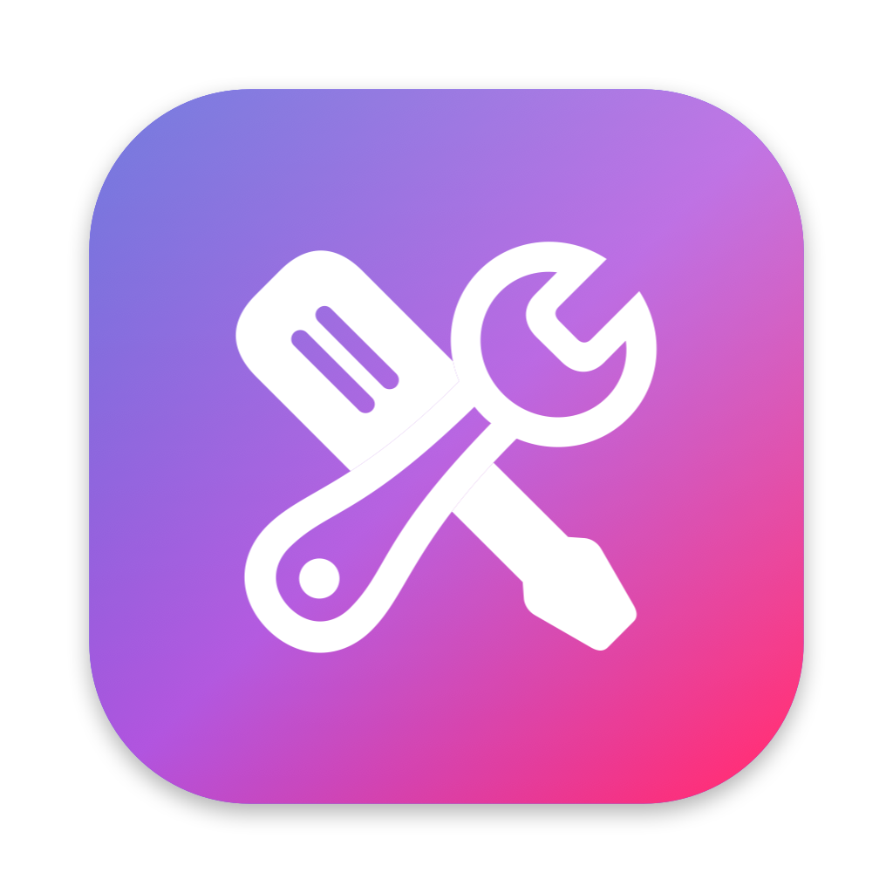
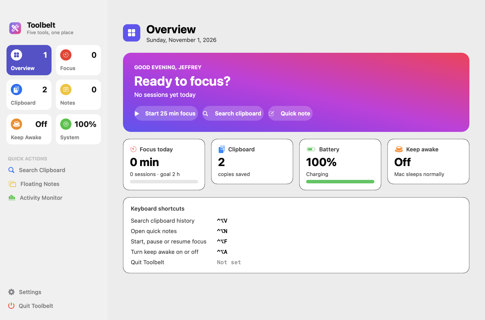
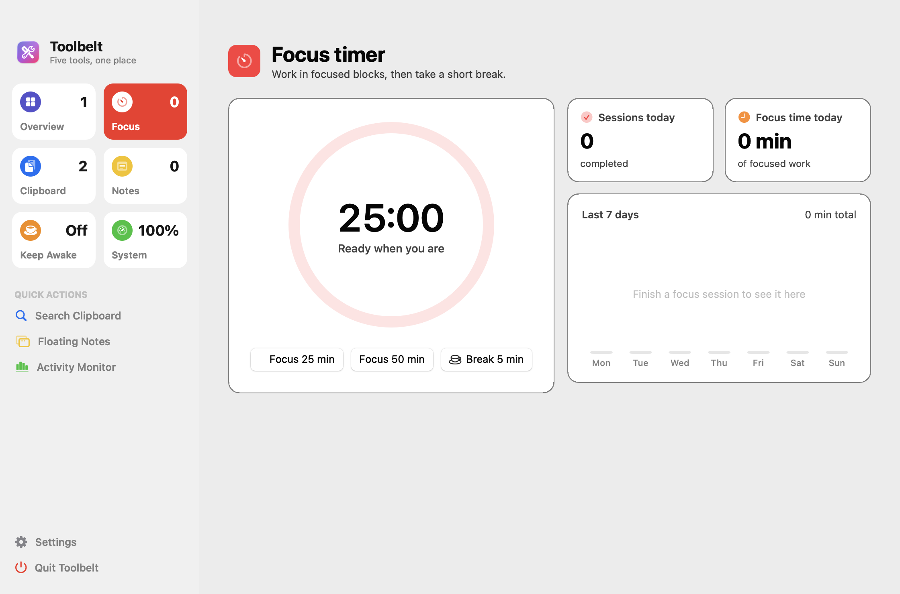
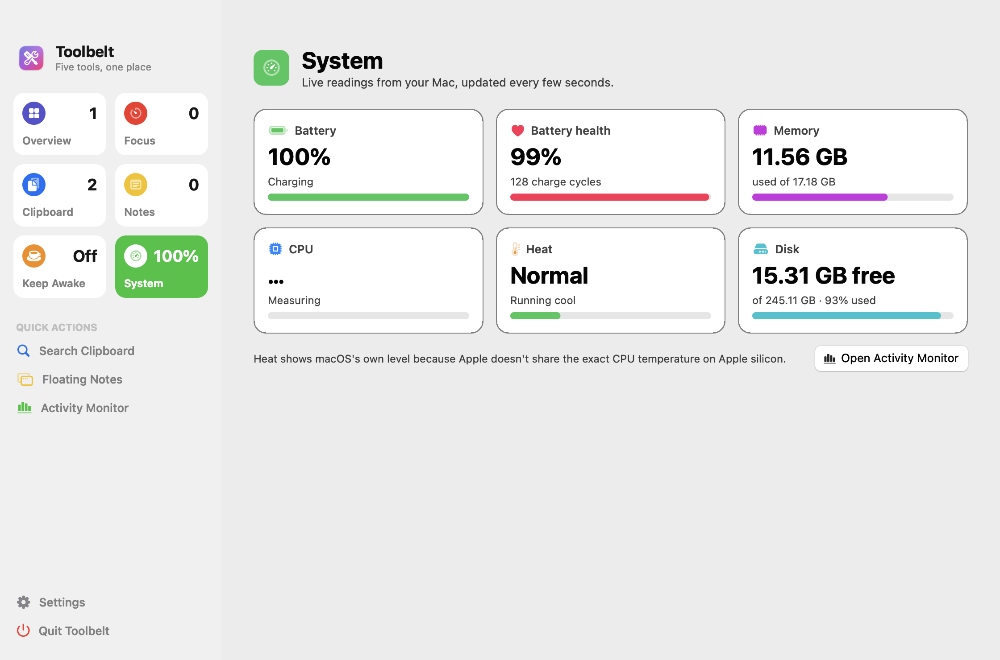
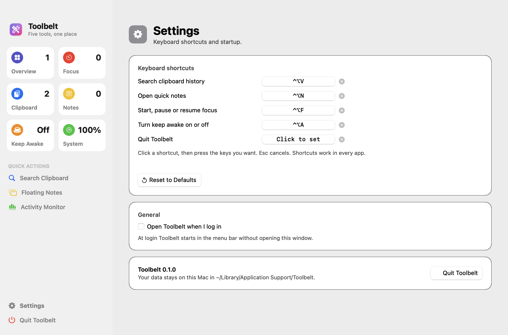

# Toolbelt

Five small Mac tools in one native app: a focus timer, clipboard history, quick notes, keep awake and a system monitor. Use them from the main window, the menu bar icon or keyboard shortcuts. Built with Swift and AppKit using only Apple's Command Line Tools: no Xcode, no accounts, nothing leaves your Mac.





| Focus | System | Settings |
| --- | --- | --- |
|  |  |  |

## The window

A translucent sidebar with a live tile for each tool, plus a page for each:

- **Overview:** greeting, focus status and quick buttons, today's numbers, and your shortcuts.
- **Focus:** a countdown ring, start, pause and stop buttons, today's totals and a 7-day chart.
- **Clipboard:** search, a full preview, Copy and Delete, pause saving, and Clear All.
- **Notes:** the full editor. It's the same text as the floating notes window, so the two stay in sync.
- **Keep Awake:** status and one-click durations.
- **System:** battery level and health, memory, CPU, heat and disk, with live bars.
- **Settings:** shortcuts, open at login and Quit.

Press ⌘1 to ⌘7 to switch pages. Closing the window keeps Toolbelt running in the menu bar; click the Dock icon or choose **Open Toolbelt** from the menu bar to bring it back.

| Tool | What it does | Default shortcut |
| --- | --- | --- |
| **Focus timer** | 25 or 50 minute focus sessions and 5 minute breaks. The countdown shows in the menu bar, a notification tells you when time's up, and the menu shows today's total. The shortcut starts 25 minutes, or pauses and resumes. | ⌃⌥F |
| **Clipboard history** | Keeps your last 50 copied texts. Search them, then press Return to paste. | ⌃⌥V |
| **Quick notes** | A floating notepad that saves as you type. | ⌃⌥N |
| **Keep awake** | Stops the Mac and display from sleeping for 1 hour, 2 hours or until you turn it off. The icon becomes a cup while it's on. The shortcut turns it on until you turn it off, or off again. | ⌃⌥A |
| **System monitor** | Battery level, health and charge cycles, memory, CPU load, heat level and free disk space. | — |

## Settings

Open the **Settings** page (⌘, or **Settings…** in the menu bar menu) to:

- **Change any shortcut.** Click it, press the new keys, or press Esc to cancel. The × removes a shortcut. Shortcuts need ⌘, ⌃ or ⌥. If you pick one another action already uses, it moves to the new action and the window tells you.
- **Add a Quit shortcut.** It has none by default, so you can't quit by accident.
- **Reset to Defaults**, **Open at login** and **Quit Toolbelt**.

Shortcuts are saved in `settings.json` next to the other data files.

## Install

```bash
./install.sh
```

This builds `Toolbelt.app`, installs it in `~/Applications` and opens it. Run it again after changing the code. To start Toolbelt when you log in, turn on **Open Toolbelt when I log in** in Settings.

Needs macOS 13 or later and the Command Line Tools (`xcode-select --install`).

## Permissions

- **Notifications:** asked on first launch, used by the focus timer. If you say no, you still hear a sound.
- **Accessibility (optional):** lets clipboard history paste for you. Choose **Turn on auto-paste…** in the menu and switch Toolbelt on in System Settings → Privacy & Security → Accessibility. Without it, choosing a copy puts it on the clipboard and you press ⌘V.

  The app is signed only for this Mac, so each rebuild looks like a new app to macOS. If auto-paste stops working after `./install.sh`, remove Toolbelt from the Accessibility list and add it again.

## Privacy

- Copies that password managers mark as secret are never saved.
- **Pause saving copies** in the menu stops recording until you turn it back on, and **Clear history** deletes everything.
- All data is stored as plain files in `~/Library/Application Support/Toolbelt/`: `clipboard.json`, `focus-log.json`, `notes.md` and `settings.json`.

## Limits

- **No CPU temperature.** Apple doesn't offer a public way to read it on Apple silicon, so Toolbelt shows the system's own heat level (normal, warm, hot, very hot) instead.
- **Clipboard history saves text only**, not images or files.

## Develop

```bash
./test.sh                 # unit tests (Swift Testing)
swift build               # debug build
./install.sh --build-only # build build/Toolbelt.app without installing
build/Toolbelt.app/Contents/MacOS/Toolbelt --snapshot ~/Desktop/shots  # PNG of every page, then quit
swift Scripts/make-icon.swift Resources/AppIcon.icns                   # redraw the app icon
```

The snapshot PNGs are for checking layout. They show the sidebar without its see-through effect, so for posts take real screenshots: press ⌘⇧4, then Space, then click the window.

- `Sources/ToolbeltCore`: plain Swift logic with no AppKit (clipboard history, focus timer and log, shortcuts, formatting, JSON storage). The unit tests cover this part.
- `Sources/Toolbelt`: one controller file per tool, plus `AppDelegate.swift` for the menus and `Support.swift` for hotkeys, notifications and launch at login.
- `Sources/Toolbelt/UI`: the main window (`MainWindow.swift`), its pages, the Settings page with the shortcut recorder, and shared pieces such as cards, rings and charts (`Components.swift`).
